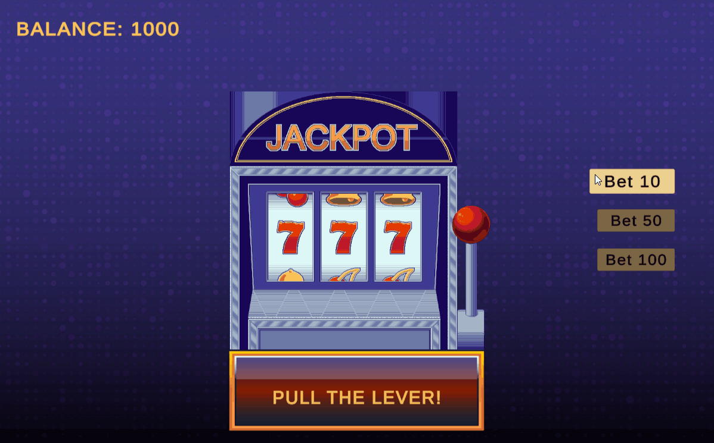

# 🎰 Slot Machine Game

A 2D slot machine game developed in **Unity 6** as part of the Underpin Services game development assignment.

The game features three animated reels, weighted random symbol generation, betting, balance management, and a payout system.

## 🎮 Gameplay Demo

<p align="center">
  
</p>

## ✨ Features

- **Three animated reels** with smooth vertical spinning and deceleration.
- **Sequential reel stopping** to create a realistic slot machine experience.
- **Weighted Random Number Generation (RNG)** to control symbol probabilities.
- **Winning combinations** when all three symbols on the middle horizontal row match.
- **Bet selection** with three available options: 10, 50, and 100 coins.
- **Balance management** with automatic bet deduction and winnings.
- **Payout system** with different multipliers for each symbol.
- **Interactive lever** to start the slot machine.

## 🎲 Symbol Probabilities and Payouts

The game uses weighted random generation to determine the symbols on each reel.

| Symbol | Probability | Payout Multiplier |
|---|---:|---:|
| Red Seven | 10% | 10x |
| Cherries | 20% | 5x |
| Bell | 30% | 3x |
| BAR | 40% | 2x |

The player wins when all three symbols on the **middle horizontal row** match.

The payout is calculated using:

`Payout = Current Bet × Symbol Multiplier`

The starting balance is **1,000 coins**.

## 🕹️ How to Play

1. Select a bet amount (10, 50, or 100 coins).
2. Pull the lever to start a spin.
3. Wait for the three reels to stop sequentially.
4. If all three middle-row symbols match, the corresponding payout is added to your balance.
5. Otherwise, the bet is lost.

## 🛠️ Built With

- Unity 6
- C#
- Unity 2D
- TextMeshPro

## 🏗️ Project Architecture

The project is organized into separate systems to keep responsibilities clear and maintainable.

| Script | Responsibility |
|---|---|
| `SlotMachineController` | Coordinates the spin process and evaluates the final result. |
| `ReelController` | Handles reel movement, animation, and stopping behaviour. |
| `SlotResultGenerator` | Generates symbols using weighted random probabilities. |
| `WinEvaluator` | Checks whether the middle-row symbols form a winning combination. |
| `PayoutCalculator` | Calculates winnings based on the selected bet and symbol multiplier. |
| `BalanceManager` | Manages the player's balance and bet deductions. |
| `SymbolView` | Updates the visual representation of a symbol. |
| `SlotMachineUI` | Handles the game's user interface. |
| `BetButtonVisual` | Handles the visual state of bet selection buttons. |
| `LeverController` | Handles interaction with the slot machine lever. |

## 📁 Project Structure

```text
UnderpinSlotMachine/
├── Assets/
│   ├── Animations/
│   ├── Art/
│   │   ├── Background/
│   │   ├── Machine/
│   │   ├── Symbols/
│   │   └── UI/
│   ├── Prefabs/
│   │   └── Symbols/
│   ├── Scenes/
│   ├── Scripts/
│   │   ├── Core/
│   │   ├── Gameplay/
│   │   ├── Reels/
│   │   └── UI/
│   └── Settings/
├── Build/
│   └── WebGL/
├── Screenshots/
│   └── Gameplay.gif
├── Packages/
└── ProjectSettings/
```

## 🌐 WebGL Build

A WebGL build is included in the repository:

`Build/WebGL/`

To run the build locally